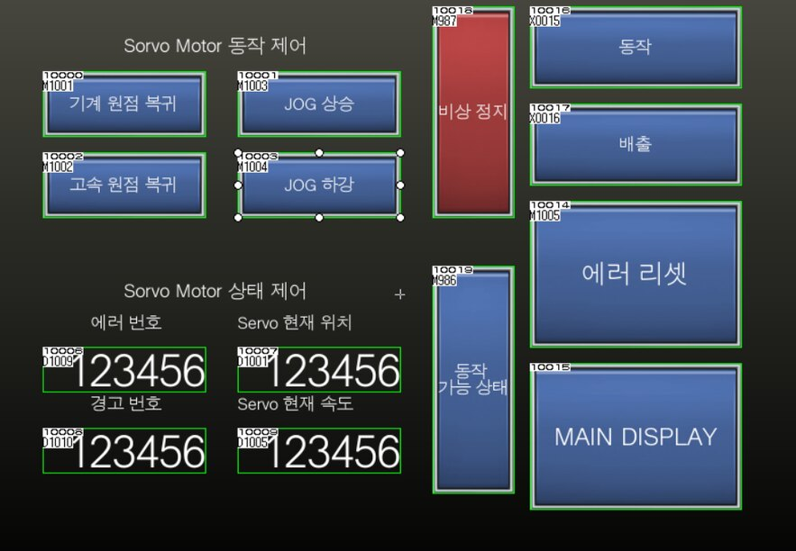
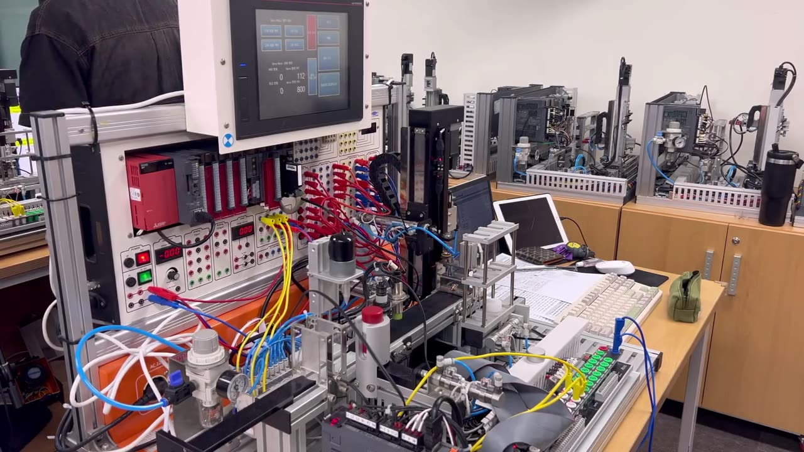
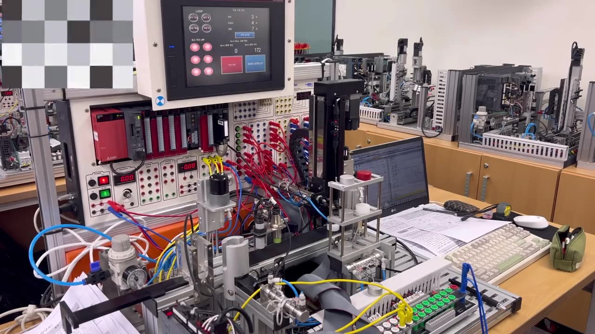
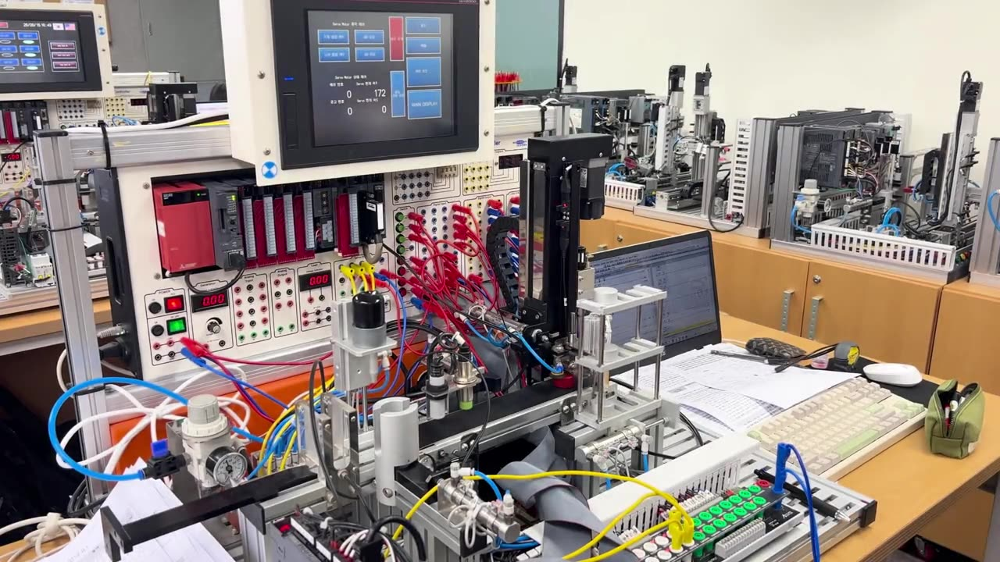

# PLC 금속·비금속 분류 적재·배출 자동화

금속과 비금속을 판별해 창고에 층별로 적재하고, 필요할 때 다시 배출하는 PLC 자동화 시스템입니다.
서보 위치결정, HMI, 비상정지까지 하나의 공정으로 구현했습니다.

**포트폴리오 · 시연 영상:** https://micoleb3.github.io/#project-plc

## 구성

| 항목 | 사용 |
|---|---|
| PLC | Mitsubishi Q03UDV |
| 모션 | QD77MS2 서보 위치결정 모듈 |
| 래더 | GX Works2 |
| HMI | GT Designer3 · GOT2000 (GT27, 800×600) |

## 공정 흐름

원점 확립 → 공급 · 분배 → 금속/비금속 판별 → 서보 흡착 · 층별 적재 → (3개 초과 시) 배출

## 담당 구현

- **모션** — QD77MS2로 층별 적재 · 흡착 위치 제어 (INCP 상대 위치결정), 원점복귀 · JOG 상승/하강
- **HMI** — 동작 상태 · 층별 적재 현황 램프, 원점복귀 · JOG 수동조작 · 배출 · 비상정지 버튼
- **안전** — M987로 자기유지(M100·M199)를 끊어 즉시 정지시키는 비상정지 설계

| HMI 화면 1 | HMI 화면 2 |
|---|---|
|  |  |

## 트러블슈팅

- **서보 층 이동 실패** — 다음 소재가 들어와도 위층으로 올라가지 않고 1층에서만 적재를 반복 → 조건 수정 후 정상 동작 확인
- **INCP 중복 실행** — 배출 시 자기유지 해제 타이밍이 맞지 않아 INCP가 중복 실행 → 초기화 조건에 동작완료 b접점을 추가해 초기화 중 INCP 차단

## 결과

- 재료 판별 · 적재 · 배출 전 공정 자동 동작, 비상정지 동작 확인
- 인수인계용 One-paper 유지보수 매뉴얼 작성 (초기화 순서 정리)

| 소재 판별 · 적재 | 소재 배출 | 비상 정지 |
|---|---|---|
|  |  |  |

## 파일

| 파일 | 내용 | 여는 프로그램 |
|---|---|---|
| `project/PLC미니프로젝트_래더.gxw` | 래더 프로그램 (MAIN · MAIN1 · OP), QD77MS2 설정, 디바이스 코멘트 | GX Works2 |
| `project/PLC미니프로젝트_HMI_GTDesigner3.zip` | HMI 화면 프로젝트 (압축 해제 후 열기) | GT Designer3 |
| `project/PLC미니프로젝트_채윤식.pcw` | PLC · HMI 통합 워크스페이스 | MELSOFT iQ Works |
| `docs/발표자료.pdf` | 프로젝트 발표자료 | — |
